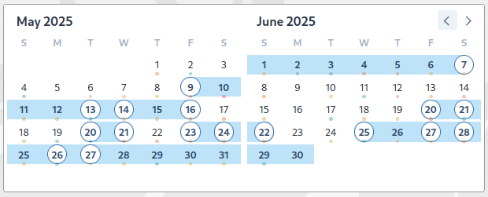
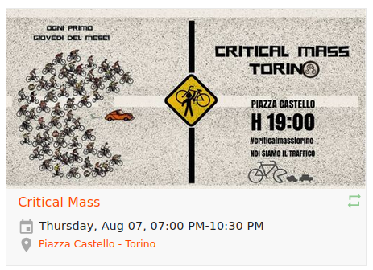
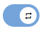

# Home page
{: .no_toc }

The homepage is all about giving you a quick look at what’s going on.

1. TOC
{:toc}

## What's in the home

In addition to the name of the node and a small description you will find a simple calendar that supports the interactions you might expect and a list of current and upcoming events.

## Calendar
Today is shown on the calendar circled.

Multi-day events are shown with a range and colored dots are shown based on the number of events scheduled each day (>20 purple, >10 red, >5 orange, >3 yellow, teal otherwise).

Pressing on a specific day will display the events for that day (or multi-day events still in progress that day).

Changing the month or year through the calendar will show the events for the selected month, this way you can use gancio as an archive.

## Events
Event's list is the same for everyone. There's no personal timeline.

Each card gives you a quick preview of the event, including:
  - A flyer or image (if one was added)
  - The name of the event
  - The date and time
  - The location

{: data-fancybox="group" data-caption="Event's card"}

There are also icons that indicate whether the event is recurring and whether it has already passed.

### Show recurring events

E' possibile impostare globalmente se gli eventi ricorrenti sono visualizzati o meno di default nella home page dal pannello di amministrazione, inoltre ogni visitatore puo' modificare questa impostazione utilizzando lo switch in alto nella barra di navigazione => 

### Show a subset of events
Esiste la possibilita' di creare sottoinsiemi di eventi (sono chiamate collection nell'interfaccia di amministrazione) che e' possibile mostrare in homepage, c'e' una sezione apposita.

### Is there another way I can stay updated?
Ogni pagina

